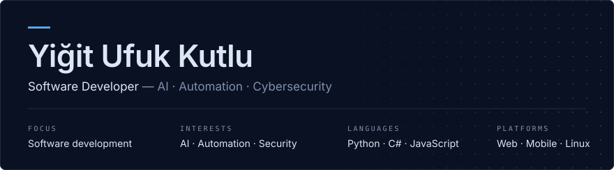

  

  

Software developer working on web and mobile applications, with a strong interest in artificial intelligence, automation and cybersecurity.
I enjoy Linux and open-source tooling, and I learn by taking systems apart to understand how they work — and how they fail.

  <b>LANGUAGES</b> 
  
  
  
  
  

  <b>MOBILE &amp; DATA</b> 
  
  
  

  <b>TOOLS &amp; OS</b> 
  
  
  
  

- **Software development** — building clean, working applications for web and mobile
- **Artificial intelligence & automation** — assistants, scripts and tooling that remove manual work
- **Cybersecurity** — learning how systems are attacked in order to build them better
- **Linux & open source** — my everyday environment and toolchain

<!-- All cards in this section update automatically -->

  
  

  

<i>Build it. Break it. Understand it. Improve it.</i>

