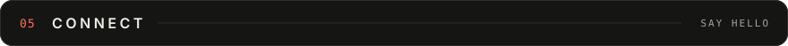

  

  
  

<!-- 01 · ABOUT -->

I'm **Yiğit Ufuk Kutlu** — a software developer and the founder of [Coremimari](https://coremimari.com).
I turn real business problems into simple, working digital systems, and I build products of my own — right now **CoreAsistan** and **Quant Core**.

When I'm not shipping, I'm taking things apart on purpose: Linux, security, automation and AI. The full story, projects and details live on **[ufukkutlu.com ↗](https://ufukkutlu.com)**.

<!-- 02 · STACK -->

  

<!-- 03 · FOCUS -->

  

<!-- 04 · STATS -->

  
  

<!-- 05 · CONNECT -->

  
  
  

  

  

