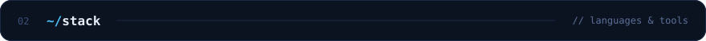
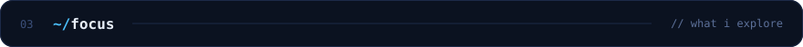
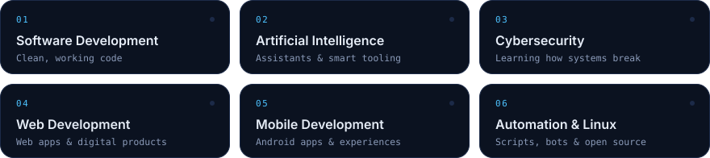

  

  
  

<!-- 01 · ABOUT -->

Software developer with a soft spot for **AI**, **automation** and **cybersecurity**.
I build web and mobile applications, tinker with Linux and open-source tools, and take things apart on purpose to understand how they work — then put them back together better.

<!-- 02 · STACK -->

  
  

  
  

  
  

<!-- 03 · FOCUS -->

  

<!-- 04 · STATS (all cards below update automatically) -->

  
  

  

  

